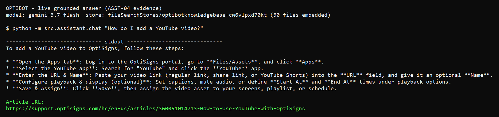

# delta-index

A support-docs RAG assistant: it scrapes 30 Help Center articles through the Zendesk Help Center API into clean Markdown, loads them into a Google Gemini File Search store through the API, and keeps the store current with a daily delta-sync job.

## Setup

Python 3.11+ (the image runs 3.13): `pip install -r requirements.txt`, then `cp .env.sample .env` and set `GOOGLE_API_KEY`.

## Run locally

```bash
python main.py   # scrape, then delta upload; prints one added= updated= skipped= deleted= store_name= line
python -m src.assistant.chat "How do I add a YouTube video?"
python -m pytest -q   # offline, no key needed
docker build -t optibot-sync .
docker run --rm -e API_KEY=<your-gemini-key> optibot-sync   # entrypoint is python main.py; runs once, exits 0
```

By design, the first run against an empty store uploads all 30 articles (`added=30`) and later runs with no upstream change print `skipped=30`. A local run rewrites the tracked `last-run.json`. The optional React chat UI is in [ui/README.md](ui/README.md).

## How it works

- The pinned 30 en-us articles come from the Zendesk Help Center API with cursor pagination, not DOM scraping.
- BeautifulSoup and markdownify clean them into `data/articles/<slug>.md` with front-matter `article_id`, `title`, `source_url`, `updated_at`.
- They are uploaded through the API to a File Search store with `source_url` metadata per document.
- Chunking: whitespace chunks of 400 tokens with 40 tokens overlap. Support articles are short how-tos, so 400 tokens keeps a heading with its steps, and the 10% overlap keeps a step that straddles a boundary retrievable.
- The File Search API exposes no chunk count, so the logged chunk figure is an estimate (characters/4 over 360-token strides). `python -m src.assistant.pipeline` prints `files_embedded=30` and `chunks_embedded_estimate=118`; use it on an empty store only, it does not delta-check.
- Delta: a per-article SHA-256 of the Markdown (falling back to Zendesk `updated_at` for older documents) is compared with each store document's metadata. Changed documents are deleted and re-uploaded; removed articles are deleted.

## Daily job

GitHub Actions runs `.github/workflows/daily-sync.yml` on `17 6 * * *` (daily 06:17 UTC) plus manual dispatch. It builds the image and runs it once, passing the `GOOGLE_API_KEY` repository secret by name as `API_KEY`.

- [Workflow runs](https://github.com/tulenguyenanh/delta-index/actions/workflows/daily-sync.yml) and the [first (manual) run](https://github.com/tulenguyenanh/delta-index/actions/runs/38681881369). Each run uploads `last-run.json` as the `last-run` artifact and writes it to the run summary; reading log text needs a GitHub login.
- Committed `last-run.json` from the verified live run: added 0, updated 0, skipped 30 (store already held the 30 documents).

## Sample answer



Captured terminal output.

## Known limits

- GitHub disables scheduled workflows after 60 days of repository inactivity.
- An updated article is deleted before its replacement uploads, so an upload failure leaves it absent until the next run.
